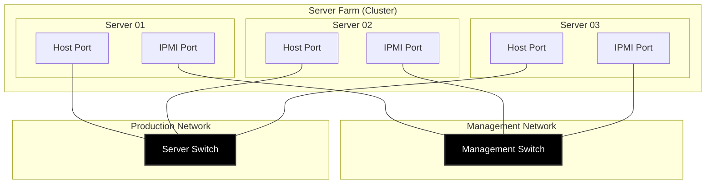

### Solution Architecture

KS product series is a cloud platform designed specifically for enterprise users. The solution’s architecture consists of the following elements.

* KS Cluster: A group of KS systems, also known as “nodes”, form a cluster that works as a single, integrated system. The nodes are connected via the storage network to communicate with one another.
* Clients: Clients access the data stored on the cluster nodes and use the service. The nodes and the clients are connected via the host network.
* Administrator’s management server: The system administrator manages the nodes in a cluster from an dedicated server by using a centralized, web-based interface called EonOne. The nodes and the management PC are connected via the management network.
* External storage: To provide high-speed data access and additional storage space, the IEC platform can integrate with storage products including EonStor GS series.
* Host network switch: For connecting the server host and transmitting jumbo-frame data between memory of nodes
* Storage network switch: For connecting the server host and transmitting persistent, jumbo-frame data between disks of nodes
* Management network switch: For connecting the server host and transmitting management command payloads, monitoring data and system-managed data between nodes

Server Network Topology Diagram

This architecture illustrates an enterprise-grade topology in which three servers are simultaneously connected to both a "server switch" (for data transmission) and a "management switch" (for out-of-band management via IPMI/iLO/iDRAC).

