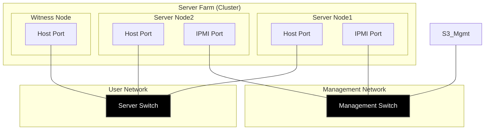

## Use Case 2611-AOI-SLA

### Customer Use Case Summary

由田新技 AOI 整合普安科技虛擬化 HA 技術, 實現晶圓封測 AOI 系統的關鍵後端資料庫系統高可用與資料保護, AOI 系統 SLA 提升至 99.99%, AOI 資料系統災難復原時間 RTO 縮短至 30分鍾

### Challenges

1. 原有架構環境：

(1)客戶原本使用的第三方產品或版本？大約有多少台主機？
Robert: 實體機運行 Windows 應用服務與 MySQL資料庫系統

(2)這套環境主要承載哪些業務或生產系統？
Robert: Windows MySQL, Windows Data Pipeline Services, Windows Dashboard Apps

2. 問題挑戰/尋找替代原因：

(1)這次想解決的問題和尋找替代方案的主要原因是什麼？
Robert: 災難復原架構解決方案縮短災難復原時間; AOI 系統多機台並發與即時資料流服務高可用; 4PB 容量 RAID 保護, 關鍵資料庫系統高可用與資料保護; 運算系統與儲存系統中心化管理減低管理負荷 

(2)是否有相關數據可供參考，例如 預期成本節省目標，或原方案與替代方案的成本差異？
Robert: 原 AOI 解決方案 SLA 90%, 新 AOI 解決方案 SLA 提升至 99.99%; 資料流與資料庫系統災難復原時間縮短至 30分鍾

3. 技術需求：

(1)實際需要移轉哪些應用程式？ (例：Windows VM、企業網域服務、MS SQL 資料庫…等)  
Robert: Windows MySQL, Windows Services, Windows Apps

(2)需滿足哪些應用需求？ (例：VM 管理、叢集管理、Active-Active HA、高可用性及故障切換…等) 
Robert: Windows MySQL VM 高可用運行, Windows App VM 高可用運行, Windows Data Service VM 高可用運行

### Solutions

系統架構圖

資料流程示意圖

4. KSi 替代方案：

(1)KSi 5008 實際搭配哪一套虛擬化平台、叢集管理或高可用性軟體？
Robert: KS 虛擬化為基於Kubernetes 雲技術架構的 KubeVirt 容器虛擬化技術

(2)新方案如何承接原有環境中的應用程式？哪些原有功能需要保留？
Robert: KS 虛擬化支持建立多個 Windows VM 運行關鍵資料服務

(3)相較於原有方案，新方案在管理方式、軟體授權或系統整合上有哪些差異？
Robert: KS HA 方案為一次性授權, 購買後享用完整使用無隠藏費用, 提供硬體3年保固與全球技術服務, 台灣區提供專人專線服務加速協作排除生產環境問題

5. POC：

(1) POC 執行多久？測試了哪些項目？
Robert: POC 包括建立KS HA 環境, 建立GS HA環境, 依展示場景進行系統設定 (建立VM, 安裝MySQL, 開發AOI系統模擬程式, 內部演練, 向客戶展示演練災難自動移轉自動復原Windows MySQL與 資料流.2次POC分別執行3工作日與1工作日.

(2)是否有明確的測試目標或驗收標準？(例： 資料庫運作、叢集功能、故障切換或應用程式相容性) 
Robert: POC目標為: Windows VM 可運行MySQL 8, 且資料服務可並行讀取寫入資料庫, 災難發生資料服務持續運行不中斷

(3) POC 的結果如何？是否有成功通過的測試項目或其他值得強調的成果？(例：讓客戶在正式採購前，確認替代方案能滿足需求、降低移轉風險) 
Robert: POC成功展示我方KS HA, GS HA 故障移轉且正常運行關鍵應用服務

(4)Infortrend Presales 技術支援或POC 服務是否為客戶選擇 Infortrend的重要因素？
Robert: 專業技術服務, POC成功, 公司品牌形象為客戶決定採購的關鍵評估因素之一

6. 移轉方法：

(1)原有 資料應用 與 MySQL 資料庫分別透過什麼方式移轉至 Infortrend Solutions？
Robert: 部署KS HA 服務器系統, 在KS 集群建立 Windows VM, 安裝 MySQL應用, 與安裝客戶端資料應用 ; 部署GS HA 儲存系統, 啟用 NAS功能

(2)移轉過程是否需要停機？若有，停機時間大約多久？
Robert: 新廠區建立生產系統 (無停機)

7. 驗收結果：

(1)移轉後是否完成資料完整性、應用程式功能及生產系統驗證？ 
Robert: 於廠內實施客戶驗收, 包括集群規劃, 測試網路設備相容性, 部署集群, 演練災難情境驗證 KS故障移轉資料庫高可用, 與 GS故障網路儲存功能高可用

(2)呈上，若有驗證，是客戶自行驗證？或是由  Infortrend presales 協助驗證？
Robert: Infortrend 技術專家實施用戶培訓, 由 Presales 現場帶領引導客戶設定操作與使用相關功能等, 立即判斷與排除問題, 加速驗收過程與客戶信賴

### Business Benefits

8. 成本與維運：

(1)導入後實際降低了哪些授權或軟體成本？(例： VMware 授權費、虛擬化軟體授權費或額外管理工具費用) 
Robert: 新投資項目商業目標是 資料與應用服務高可用確保 AOI 系統 SLA; 運算系統與儲存系統中心化管理, 減低維運負荷

(2)呈上，是否有替代前後的成本比較或預估節省比例？
Robert: 無其他競爭者的資訊

(3)新方案是否簡化叢集與節點管理、減少額外工具需求，或降低日常維運的複雜度？ 
Robert: KS HA 與 GS HA 高可用有效確保 AOI 系統 SLA; 中心化管理減低維運負荷

9. 選擇 Infortrend 的原因：

(1)客戶最終選擇 KSi 的主要考量是什麼？(例：成本最低、有提供 MS SQL DB 遷移的技術支援、有做 POC…等) 
Robert: KS HA POC 展示應用服務高可用 與應用資料保護; 
GS HA POC 展示資料高可用 與 4PB 資料安全機制;
原廠技術培訓;
原廠驗收服務;
原廠 3 年硬體保固與技術服務;
原廠專線服務;

(2)是否有客戶回饋、採購考量或其他具體資訊，可以說明 Infortrend 相較於其他替代方案的優勢？
Robert: KS GS 高可用產品符合專案需求, 台灣在地服務與專人專線服務降低災難復原成本

